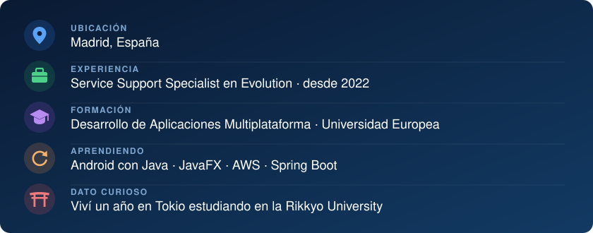

  

  
  
  
  

### Sobre mí

Estudio 2.º de **Desarrollo de Aplicaciones Multiplataforma (DAM)** y trabajo desde 2022 como **Service Support Specialist** en Evolution, donde analizo logs con Kibana y gestiono incidencias en JIRA en un entorno internacional de alta disponibilidad. Busco prácticas en **desarrollo de software o QA/testing**.

  

---

### Tecnologías

<table>
  <tr>
    <th align="center">Lo que uso</th>
    <th align="center">Lo que estoy aprendiendo</th>
    <th align="center">En el trabajo</th>
  </tr>
  <tr>
    <td align="center" valign="top">
        
        
        
        
        
        
       
    </td>
    <td align="center" valign="top">
       
       
       
       
      
    </td>
    <td align="center" valign="top">
       
       
      
    </td>
  </tr>
</table>

**También:** Java Swing · JDBC · JUnit · patrones MVC y DAO · Scrum

---

### Proyectos

**[🎬 RentFlix](https://github.com/beleriand9/RentFlix)** · Aplicación de escritorio para gestionar un videoclub, con roles de cliente, empleado y administrador. Arquitectura MVC + DAO, base de datos SQLite con JDBC, pruebas con JUnit y trabajo en sprints con Scrum. 
`Java` `Swing` `SQLite` `JDBC` `JUnit`

**[🎮 GameCrypt](https://github.com/beleriand9/GameCrypt)** · Aplicación web de videojuegos con gestión de usuarios (CRUD), autenticación y sentencias preparadas contra inyección SQL. 
`HTML` `CSS` `JavaScript` `PHP` `MySQL`

---

### Idiomas

🇪🇸 Español &nbsp; 
🇬🇧 Inglés &nbsp;  
🇯🇵 Japonés &nbsp;
